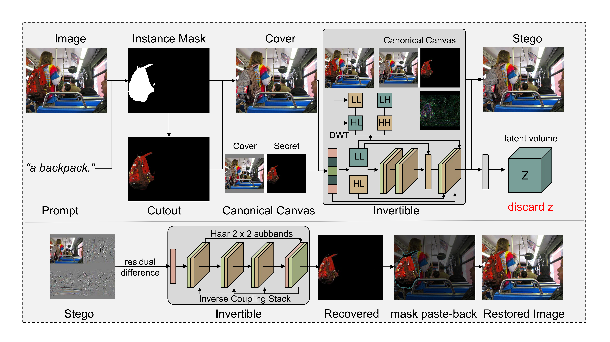

<h1 align="center">StegoAnything</h1>

<h3 align="center">
Text-Guided Reversible Object Hiding with Zero-Latent Decoding
</h3>

<p align="center">
  <strong>Expert Systems with Applications · 2026</strong>
</p>

<p align="center">
  <a href="https://doi.org/10.1016/j.eswa.2026.135076">
    
  </a>
  <a href="https://doi.org/10.1016/j.eswa.2026.135076">
    
  </a>
  
  
</p>

<p align="center">
  <a href="https://doi.org/10.1016/j.eswa.2026.135076"><strong>Paper</strong></a>
  ·
  <a href="#installation"><strong>Installation</strong></a>
  ·
  <a href="#quick-start"><strong>Quick Start</strong></a>
  ·
  <a href="#citation"><strong>Citation</strong></a>
</p>

<p align="center">
  Official implementation of <em>StegoAnything: Text-Guided Reversible Object Hiding with Zero-Latent Decoding</em>.
</p>

---

## TL;DR

> **Hide a selected object behind a same-class replacement, then recover it using a fixed zero latent.**
> StegoAnything combines text-guided object localization, semantic cover generation, and invertible image hiding to support high-fidelity object recovery without transmitting the true forward latent.

<p align="center">
  
</p>

<p align="center">
  <em>Overview of StegoAnything: text-guided object localization, same-class semantic cover generation, reversible hiding, and zero-latent decoding.</em>
</p>

## Overview

Given an image and a class prompt (`a {class}.`), StegoAnything:

1. **Localizes the target object** using Grounded-SAM-2, with an optional click to distinguish objects of the same class.
2. **Generates a same-class semantic cover** using BrushNet.
3. **Hides the original object secret** `S = M ⊙ I` using a full-canvas invertible hiding network.
4. **Recovers the secret with `z = 0`** and composites it into the image using the target mask.

```text
Image + class text (+ optional click)
    → Grounded-SAM-2 localization
    → BrushNet same-class cover
    → 256×256 full-canvas hiding
    → Secret recovery with z = 0
    → Mask-guided object restoration
```

The restoration step is:

```text
restored = (1 − M) ⊙ stego + M ⊙ recovered_secret
```

Recovery provides a high-fidelity approximation of the original object rather than guaranteed pixel-exact reconstruction. The receiver requires the corresponding model, target mask, and geometric information for canvas mapping.

### Release scope

This repository contains a cleaned public release of the **StegoAnything method**, including its HiNet-style invertible hiding network.

The official comparison baseline implementations—HiNet, UDH, DDH, StegFormer, DeepMIH, IICNet, and StegTransX—are not included.

## News

- **2026-11-13:** This repository provides the official implementation of [StegoAnything: Text-Guided Reversible Object Hiding with Zero-Latent Decoding](https://doi.org/10.1016/j.eswa.2026.135076).

## Available Demos

| Demo | Additional downloads | Command |
|---|---|---|
| **Hide + zero-latent recovery** | No additional model or dataset downloads | `python scripts/demo_hide_recover.py` |
| Full text-to-restoration pipeline | External code and pretrained models | `python scripts/demo_e2e.py` |

**Start with the hide/recover demo.** It uses three bundled example tuples containing a prepared cover, target mask, and original image, together with the bundled hiding checkpoint.

## Installation

Use **Python 3.10**. An NVIDIA GPU with a compatible CUDA environment is recommended.

```bash
conda create -n stegoanything python=3.10 -y
conda activate stegoanything

pip install torch torchvision --index-url https://download.pytorch.org/whl/cu124
pip install -r requirements.txt
```

CPU execution is supported for the hide/recover demo but is slower. The full end-to-end demo requires CUDA.

## Quick Start

### Run all bundled examples

From the repository root:

```bash
python scripts/demo_hide_recover.py
```

### Run a single example

```bash
python scripts/demo_hide_recover.py --example cat
```

### Outputs

Results are saved to `outputs/demo_hide_recover/{cat,dog,backpack}/`.

Each example directory contains:

| File | Description |
|---|---|
| `stego.png` | Container image carrying the hidden object information |
| `recovered_secret.png` | Object secret recovered with `z = 0` |
| `restored.png` | Image restored using the known target mask |
| `panel.png` | Side-by-side visualization |
| `metrics.json` | Evaluation metrics |

### Bundled checkpoint

| Item | Details |
|---|---|
| Path | `checkpoints/hinet_full_canvas_seed0.pt` |
| Configuration | Formal Full-Canvas model, seed 0 |
| Size | Approximately 9.4 MB |

## Full Pipeline

The full pipeline additionally requires Grounded-SAM-2, BrushNet, and their pretrained weights.

### 1. Download external code

Clone the repositories into these exact directories:

```bash
git clone https://github.com/IDEA-Research/Grounded-SAM-2.git third_party/grounded-sam-2
git clone https://github.com/TencentARC/BrushNet.git third_party/BrushNet
```

Install the Grounded-SAM-2 packages:

```bash
pip install -e "third_party/grounded-sam-2[notebooks]"
pip install --no-build-isolation -e third_party/grounded-sam-2/grounding_dino
```

For BrushNet, add `third_party/BrushNet/src` to `PYTHONPATH`, or install its package:

```bash
pip install -e third_party/BrushNet
```

<details>
<summary><strong>Dependency compatibility</strong></summary>

The segmentation and generation stages may require different dependency versions:

| Stage | Dependencies |
|---|---|
| Grounded-SAM-2 segmentation | May require `transformers==4.33.2` |
| BrushNet generation | May require `transformers==4.38.2` and `accelerate==0.20.3` |

If these dependencies conflict in one environment, use separate Conda environments, such as `stego-seg` and `stego-gen`, for the corresponding stages, as in the paper experiments.

</details>

### 2. Download pretrained weights

| Model | Required location | Download source |
|---|---|---|
| GroundingDINO Swin-T | `checkpoints/grounded_sam2/groundingdino_swint_ogc.pth` | [GroundingDINO releases](https://github.com/IDEA-Research/GroundingDINO/releases) |
| SAM 2.1 Hiera-L | `checkpoints/grounded_sam2/sam2.1_hiera_large.pt` | [SAM 2 checkpoints](https://github.com/facebookresearch/sam2) |
| Stable Diffusion 1.5 | `checkpoints/brushnet/stable-diffusion-v1-5/` | [`runwayml/stable-diffusion-v1-5`](https://huggingface.co/runwayml/stable-diffusion-v1-5) |
| BrushNet segmentation-mask model | `checkpoints/brushnet/segmentation_mask_brushnet_ckpt/` | [BrushNet](https://github.com/TencentARC/BrushNet) / [`TencentARC/BrushNet`](https://huggingface.co/TencentARC/BrushNet) |

Create the parent directories:

```bash
mkdir -p checkpoints/grounded_sam2 checkpoints/brushnet
```

Place the downloaded files in the locations above. Model paths are also listed in `configs/paths.yaml`.

### 3. Run the end-to-end demo

```bash
python scripts/demo_e2e.py --image examples/cat/original_full.png --class-name cat
```

To distinguish between objects of the same class, provide an optional click using pixel coordinates `x,y` in the original image:

```bash
python scripts/demo_e2e.py --image examples/dog/original_full.png --class-name dog --click 320,200
```

## Datasets

COCO and LVIS downloads are optional and are intended for paper-scale evaluation. Neither demo requires the full datasets.

| Dataset | Suggested location | Source |
|---|---|---|
| COCO 2017 validation images | `data/coco2017/val2017/` | [COCO downloads](https://cocodataset.org/#download) |
| LVIS v1 validation annotations | `data/lvis/annotations/lvis_v1_val.json` | [LVIS dataset](https://www.lvisdataset.org/dataset) |

The three examples under `examples/` are derived from COCO/LVIS samples. Source images remain subject to their individual original licenses.

## Repository Structure

| Path | Description |
|---|---|
| `stegoanything/models/` | HiNet-style invertible hiding and recovery |
| `stegoanything/hiding/` | Checkpoint loading |
| `stegoanything/pipeline/` | Canvas processing and full pipeline |
| `stegoanything/generation/` | BrushNet adapter |
| `stegoanything/segmentation/` | Grounded-SAM-2 adapter |
| `stegoanything/selection/` | Text-guided and optional-click selection |
| `stegoanything/metrics/` | Evaluation metrics |
| `scripts/demo_hide_recover.py` | Hide and zero-latent recovery demo |
| `scripts/demo_e2e.py` | Full pipeline demo |
| `examples/` | Cat, dog, and backpack example tuples |
| `checkpoints/` | Bundled checkpoint and external model locations |
| `third_party/` | External repositories |
| `figures/method_overview.png` | Method overview figure |
| `configs/paths.yaml` | Model and resource paths |

## Method Notes

| Component | Protocol |
|---|---|
| Canvas | `256×256`, with letterboxing |
| RGB normalization | `uint8 / 127.5 - 1`, mapping values to `[-1, 1]` |
| Object secret | `S = M ⊙ I` |
| Deployment recovery | `recover_from_stego(stego, z=0)` |
| Forward latent | Never transmitted |
| Network input | The target mask is not an input to the hiding/recovery network |
| Restoration | Mask-guided compositing of the recovered secret |
| Original-resolution output | Uses the corresponding inverse geometric mapping |

The mask is used for secret construction, masked restoration, and region-specific evaluation.

Canvas-space secret reconstruction and original-resolution object restoration are distinct evaluations and should be reported separately.

The formal three-seed LVIS results in the paper use the same hiding and zero-latent recovery protocol. The bundled demo checkpoint corresponds to seed 0.

## Citation

If you use this code or build upon this work, please cite:

> **StegoAnything: Text-Guided Reversible Object Hiding with Zero-Latent Decoding.**  
> *Expert Systems with Applications*, 2026.  
> DOI: [10.1016/j.eswa.2026.135076](https://doi.org/10.1016/j.eswa.2026.135076)

Please use the publisher's citation export for the complete author list and final bibliographic metadata.

## Acknowledgments

This work builds upon the following open-source projects:

- [Grounded-SAM-2](https://github.com/IDEA-Research/Grounded-SAM-2)
- [BrushNet](https://github.com/TencentARC/BrushNet)
- [Stable Diffusion 1.5](https://huggingface.co/runwayml/stable-diffusion-v1-5)
- [HiNet](https://github.com/TomTomTommi/HiNet)

We thank the authors for making their code and pretrained models available. Please also cite the relevant original works when using these components.

External code, pretrained weights, and datasets remain subject to their respective licenses and terms of use.
